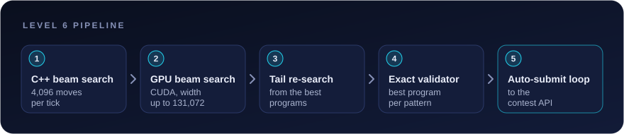
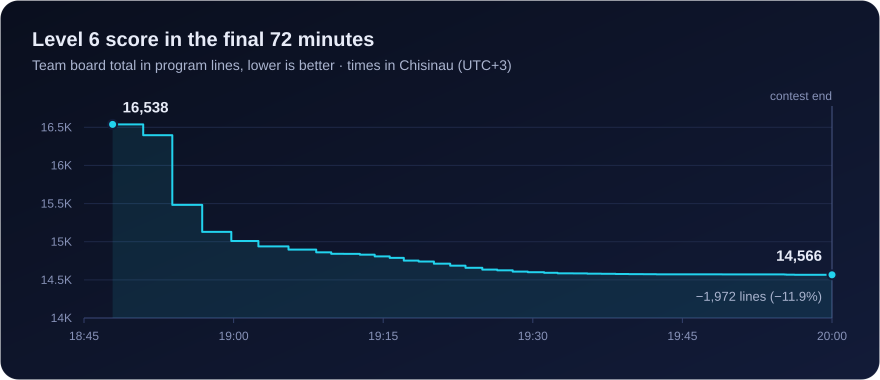

# CCC_UTM_Classic_2026 - Team Solutions

Uploaded files from CCC 2026 42nd #Classic with our team solutions and test data.

<p align="center">
  
</p>

<p align="center">
  
  
  
</p>

## Theme of 42nd edition: Nanofabricator

> *In a cleanroom so clean that even the dust must wear a hairnet, Dr. Ångström has just switched on FAB-42, the world's first nanofabricator. It doesn't print, carve or mill anything. It creates matter with laser light, one hexagonal cell at a time.*

Six laser emitters ride on a rail around a hexagonal board. On every tick each emitter moves forward (`F`), moves back (`B`), toggles its laser (`T`) or waits (`-`). A cell hit by exactly **two** beams becomes matter, and **three or more** beams destroy it. When the whole pattern stands in its exact place with nothing touching it, the pick-up arm collects it.

<p align="center">
  
  
</p>
<p align="center"><sub>Two of our real level 6 programs, replayed tick by tick. <b>Left:</b> a 36-cell pattern is built up over five ticks and collected 5 times in 27 lines. <b>Right:</b> three setup ticks yield the first copy on tick 3. From then on five lasers stay in place; triple crossings erase every cell that would touch the pattern, so FAB-42 rebuilds and collects it on every tick, 17 times in 19 lines.</sub></p>

## Results

We solved all **6 levels** and finished with:
- 🥇 **Local Moldova (UTM): 1st place**
- 🌍 **Global: 14th place**
- ⚡ **Level 6 (optimization): 14,566** program lines in total, lower is better

| Input | Patterns | Board radius | Lines | Lines per pattern |
|:--|--:|:--:|--:|--:|
| `2-medium` | 210 | 3–5 | 5,806 | 27.6 |
| `3-large` | 190 | 6–8 | 4,664 | 24.5 |
| `4-enormous` | 140 | 9–12 | 4,096 | 29.3 |
| **Total** | **540** | | **14,566** | **27.0** |

## Levels

| Level | FAB-42 says | Task |
|:-:|:--|:--|
| 1 | `software ...... NOT FOUND` | Print the hexagonal board for each radius |
| 2 | `emitter ....... ARMED` | One emitter: every cell its beam hits becomes matter |
| 3 | `beam power .... 50%` | Up to six emitters: two beams create matter, three or more destroy it |
| 4 | `RUN? [y/N]` | Run emitter programs (`F`, `B`, `T`, `-`) tick by tick |
| 5 | `pattern ....... LOADED` | Detect finished patterns and count how many get submitted |
| 6 | `incoming challenge ... PER TICK` | **Optimization:** the shortest programs that make each pattern the required number of times |

Levels 1–5 are solved in C++ (`level_N/Solution/level_N.cpp`). Level 6 lives in `level_6/opt/`.

## Level 6: the shortest programs

Every tick offers 4<sup>6</sup> = 4,096 possible instruction lines, and a program needs a few dozen of them, so we treated level 6 as a search problem and ran it on both the CPU and the GPU.

<p align="center">
  
</p>

- **Beam search.** A state is the emitter positions, which lasers are on, the matter on the board and the copies collected so far. States are deduplicated on the pattern cells only, which keeps the beam diverse (`bs6s.cpp`, `bs6p.cpp`).
- **On the GPU.** The same search as CUDA kernels compiled at runtime through CuPy, with beam widths up to 131,072 (`gpu6.py`, `gpu6snap.py`).
- **Tail re-search.** Cut the best program part-way through (at fixed fractions of its length, or right after a collection), replay the prefix and search the rest again from that exact state, keeping only strictly shorter endings (`tail6g*.py`, `tailA.py`, `post6.cpp`).
- **Closer to the real rules.** Let the search rebuild destroyed cells and keep temporary matter next to the pattern, and rerank by a lower bound on the remaining ticks (`gpu6r.py`, `gpu6a.py`, `gpu6L.py`).
- **Never lose a gain.** Every candidate is checked by an exact simulator, the shortest valid program per pattern is merged (`nano6.py`, `merge6.py`), and a loop submitted every file that beat the board until the final seconds of the contest.

<p align="center">
  
</p>

| Input | 18:47 (first loop round) | Final | Change |
|:--|--:|--:|--:|
| `2-medium` | 6,105 | 5,806 | −299 |
| `3-large` | 5,357 | 4,664 | −693 |
| `4-enormous` | 5,076 | 4,096 | −980 |
| **Total** | **16,538** | **14,566** | **−1,972 (−11.9%)** |

## Score timeline: the whole contest

The board total for level 6 from the first submission to the last, every time it changed by at least 250 lines (full list of all 82 changes in [`stats/timeline_full.csv`](stats/timeline_full.csv)). The first hour is the algorithm changing (greedy cell-by-cell → row sweeps → two-row sweeps → tick-level beam search); after that the beam only gets wider, more diverse and more parallel, and the per-case merge keeps the best program per pattern from every run.

| Time | medium | large | enormous | Total |
|:-:|--:|--:|--:|--:|
| 16:08 | 68,898 | 64,705 | 64,218 | **197,821** |
| 16:13 | 32,015 | 29,551 | 28,053 | **89,619** |
| 16:18 | 25,482 | 21,366 | 17,579 | **64,427** |
| 16:27 | 7,095 | 6,788 | 17,579 | **31,462** |
| 16:29 | 7,095 | 6,788 | 6,112 | **19,995** |
| 16:32 | 6,742 | 6,788 | 6,112 | **19,642** |
| 16:38 | 6,742 | 6,255 | 6,112 | **19,109** |
| 16:55 | 6,290 | 6,255 | 6,112 | **18,657** |
| 17:46 | 6,167 | 6,243 | 5,990 | **18,400** |
| 17:50 | 6,167 | 5,749 | 5,521 | **17,437** |
| 18:14 | 6,167 | 5,599 | 5,286 | **17,052** |
| 18:44 | 6,105 | 5,408 | 5,151 | **16,664** |
| 18:51 | 6,023 | 5,313 | 4,890 | **16,226** |
| 18:54 | 5,950 | 5,162 | 4,858 | **15,970** |
| 18:54 | 5,933 | 5,129 | 4,370 | **15,432** |
| 18:57 | 5,898 | 4,855 | 4,363 | **15,116** |
| 19:08 | 5,879 | 4,732 | 4,242 | **14,853** |
| 19:29 | 5,807 | 4,674 | 4,119 | **14,600** |
| 19:56 | 5,806 | 4,664 | 4,096 | **14,566** |

| Stage | Method | medium | large | enormous |
|:--|:--|--:|--:|--:|
| 16:08 | greedy: two beams per cell | 68,898 | 64,705 | 64,218 |
| 16:13 | one fixed beam + one sweeping beam per row | 32,015 | 29,551 | 28,053 |
| 16:18 | two rows per sweep, twin emitter across gaps | 25,482 | 21,366 | 17,579 |
| 16:29 | C++ beam search, W=64 | 7,095 | 6,788 | 6,112 |
| 17:50 | + relaxed stray rule, W=256 | 6,167 | 5,749 | 5,521 |
| 18:54 | + GPU search (W up to 131,072), pattern-only dedupe, tail re-search | 5,933 | 5,129 | 4,370 |
| 19:56 | + post-optimisation and merges until the last minute | 5,806 | 4,664 | 4,096 |

Every candidate file produced during the contest, scored with the exact simulator, is listed in [`stats/stats.md`](stats/stats.md); the final programs are the per-pattern best over all of them.

## Repository structure

```text
CCC.zip
├── level_1 … level_5
│   ├── statement.txt
│   ├── input/           inputs, example output, statement PDF
│   ├── output/          our outputs
│   ├── Solution/        final C++ solution
│   └── tried_working/   earlier attempts
└── level_6
    ├── statement.txt
    ├── input/           example, small, medium, large, enormous
    └── opt/             solvers, tools, logs and outputs
        ├── w_*.out      final submitted programs
        ├── agents/      extra solvers: CPU tail, heuristic, cycle search, post-optimizer
        └── win_scripts/ merge and auto-submit loop
assets/                  README visuals, rendered from our real programs and submit log
```

## Run it yourself

```bash
unzip CCC.zip
cd level_6/opt
# validate and score a solution file
python3 nano6.py score ../input/in_level-6_2-medium.txt w_2-medium.out

# CPU beam search: <in> <out> [W0] [threads] [budget_s] [Wmax] [reverse]
g++ -O2 -std=c++17 -pthread bs6s.cpp -o bs6s
./bs6s ../input/in_level-6_3-large.txt large.out 64 8 20 4096

# GPU beam search (NVIDIA GPU + CuPy): <in> <out> <beam width>
python3 gpu6.py ../input/in_level-6_4-enormous.txt enormous.out 16384
```

## License

[MIT](LICENSE)
